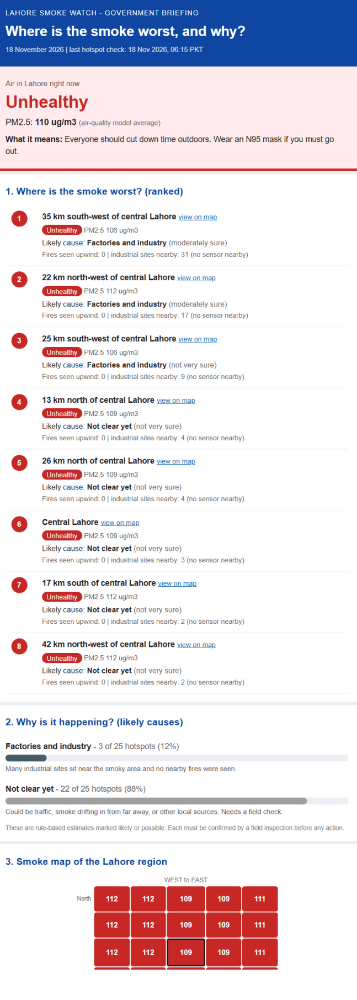
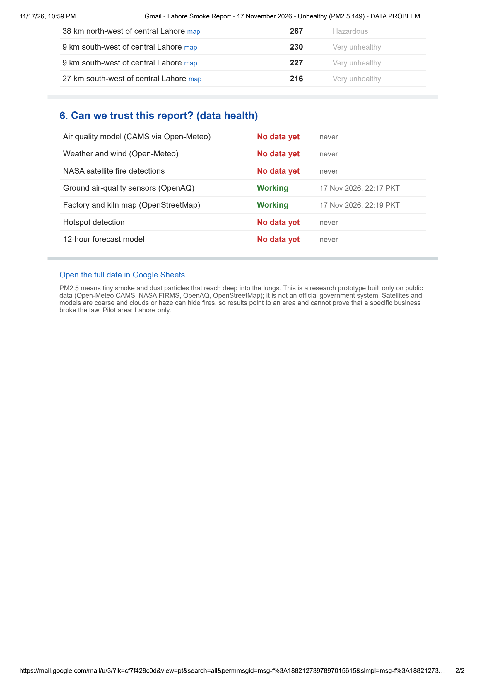
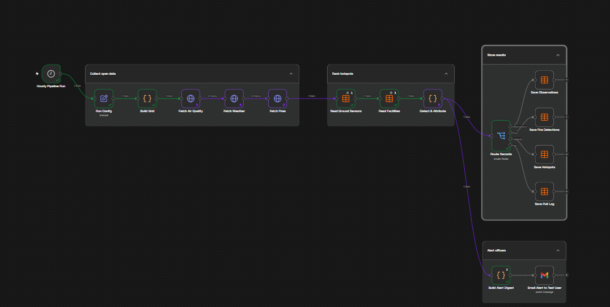

# AIAutomation — Intelligent Systems & Environmental Analytics

A collection of production **n8n automation workflows**, **AI agents**, and **environmental data pipelines** engineered by **Abdullah Naveed**.

---

## Featured Project: Lahore Smoke Watch (`v1.0.0`)

An automated air quality monitoring, hotspot attribution, and PM2.5 forecasting pipeline built for **Lahore, Punjab, Pakistan**. It integrates satellite fire detections, ground sensors, meteorological reanalysis, and industrial zoning data to identify smoke sources and generate plain-language public health briefings.

### Architecture (6 Modular Workflows)
| # | Workflow | Schedule | Core Function |
|---|---|---|---|
| **1** | **Data Pipeline & Hotspot Detection** | Hourly | Pulls Open-Meteo (CAMS) weather/air quality & NASA FIRMS fire data across a 25-cell Lahore grid, clusters fires, flags hotspots, and attributes likely causes (crop burning, brick kilns, industrial). |
| **2** | **12-Hour PM2.5 Forecast** | Every 3 hrs | Trains a ridge regression model on 60 days of history and benchmarks MAE/RMSE against persistence and seasonal baselines. |
| **3** | **OSM Industrial & Kiln Refresh** | Weekly | Queries OpenStreetMap Overpass API to map brick kilns, factories, and industrial zones around Lahore. |
| **4** | **Ground Sensors (OpenAQ)** | Hourly | Ingests live PM2.5 readings from 30+ ground monitoring stations in Lahore and logs API health. |
| **5** | **Officer Dashboard** | Webhook | Serves a zero-script, low-bandwidth HTML/SVG situational dashboard with ranked hotspots and source health. |
| **6** | **Google Sheets Sync & Email Digest** | Twice Daily | Exports all 6 data tables to Google Sheets and emails a non-specialist public health summary via Gmail. |
### Live System Preview

### Setup & Import Guide
1. **Create 6 n8n Data Tables:** `smoke_observations`, `smoke_fires`, `smoke_hotspots`, `smoke_forecasts`, `smoke_facilities`, and `smoke_pull_log`.
2. **Import Workflows:** In n8n, open **Workflows → Add workflow → Import from File** and upload each `.json` file from `lahore-smoke-watch/workflows/`.
3. **Add API Keys:** Configure credentials for **NASA FIRMS (`MAP_KEY`)**, **OpenAQ**, **Google Sheets**, and **Gmail** in the respective setup nodes.
4. **Initialize & Publish:** Execute **Workflow 3** (facilities) and **Workflow 4** (ground sensors) once to seed baseline tables, then activate all schedules.

---

* **[Healthcare AI](./healthcare-ai):** Neurological patient assessment logging (`BrainGuard AI`) and automated clinic appointment scheduling.
* **[Business & Operations](./business-automation):** End-to-end solar company pipeline automation and US consultancy intake workflows.
* **[Data & Messaging Agents](./data-and-messaging-agents):** Cross-platform Telegram + Gmail automated data analysis pipelines and conversational AI agents.

## Repository Project Timeline
* **[lahore-smoke-watch](./lahore-smoke-watch)** *(Nov 2026)* — Automated PM2.5 hotspot attribution, ridge regression forecasting, and low-bandwidth officer dashboard.
* **[business-automation](./business-automation)** *(Feb – Aug 2026)* — End-to-end solar company pipeline and US consultancy intake automation.
* **[healthcare-ai](./healthcare-ai)** *(Feb – May 2026)* — BrainGuard AI neurological assessment records and automated clinic scheduling agents.
* **[data-and-messaging-agents](./data-and-messaging-agents)** *(Feb – Jun 2026)* — Cross-platform Telegram + Gmail automated data analysis pipelines and AI chat agents.

---

## Author
**Abdullah Naveed**  
Computer Science Student & AI Automation Builder — Gujranwala / Lahore, Pakistan  
GitHub: [@AbdullahNaveed-CS](https://github.com/AbdullahNaveed-CS)
